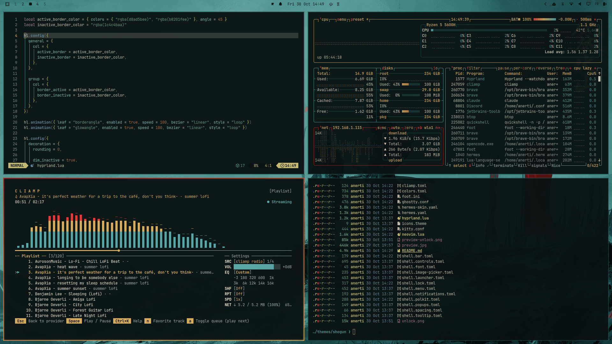
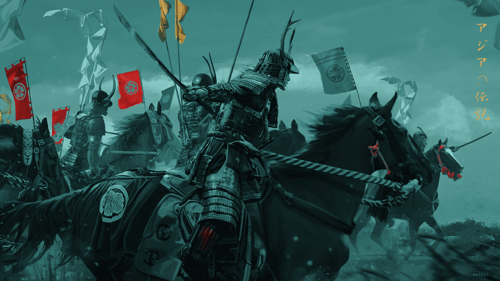
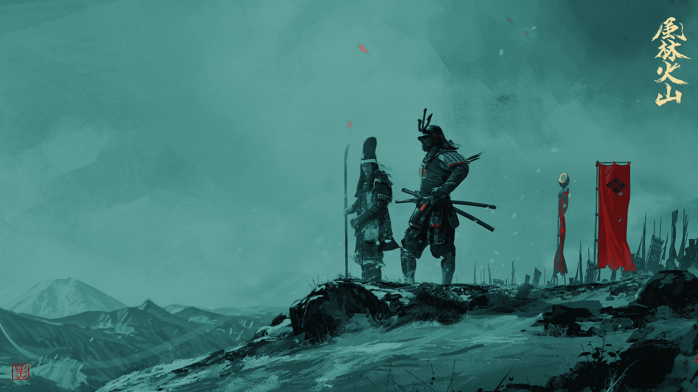
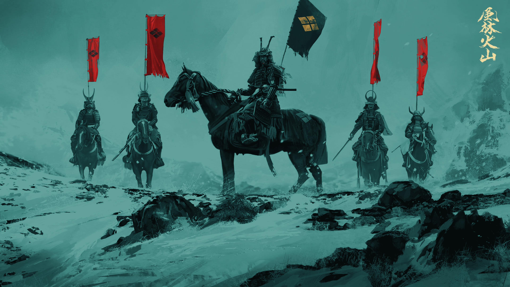
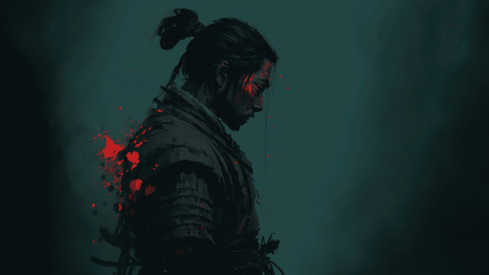
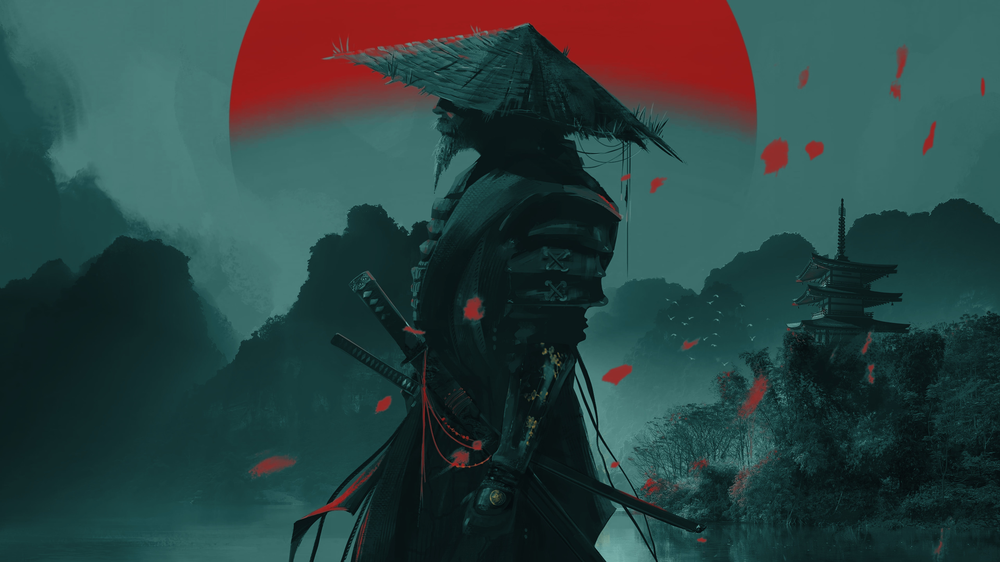
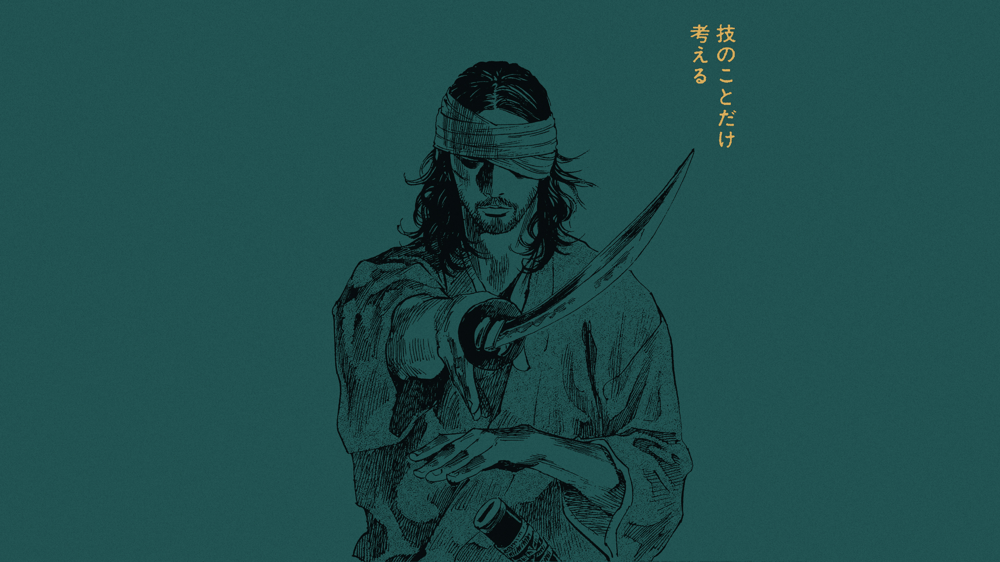
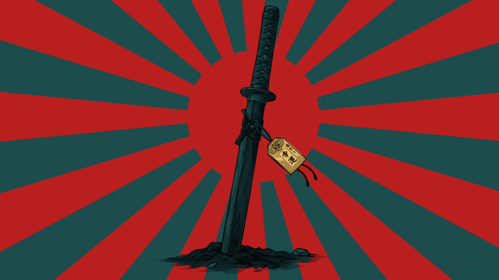
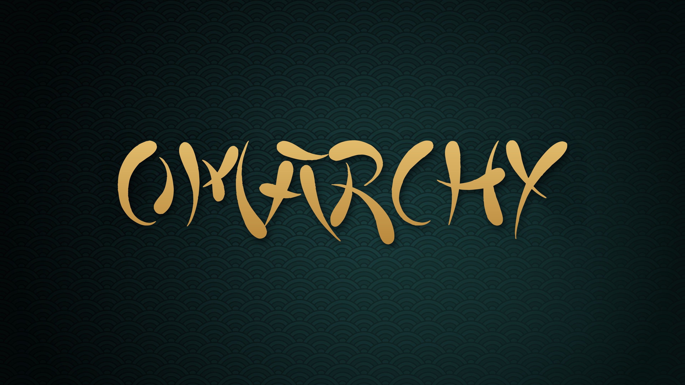

# Shogun

A dark Omarchy theme drawn from the palette of a samurai charge: deep teal haze, lacquer-red banners, aged gold armor and parchment light.

   




Neovim, btop, cliamp and eza on the Riders wallpaper. The focused window wears a slowly rotating gold-to-crimson border with a matching inner glow; the others are dimmed a little and sit on blurred, translucent backgrounds.

## Wallpaper Gallery

This theme includes eight wallpapers, each graded to the theme's teal haze with banners in crimson and lettering in armor gold.

| Preview | Artwork |
| ------- | ------- |
|  | Legend: Benzal's アジアの伝説 cavalry charge, with crimson clan banners and gold streamers |
|  | Commander: Benzal's mounted general under falling petals, 風林火山 and the ring standard in gold |
|  | Riders: Benzal's 風林火山 riders in the snow, four crimson nobori and a black flag with a gold crest |
|  | Ronin: an ink-wash samurai with his head bowed, the blood spatter kept in banner crimson |
|  | Pagoda: a straw-hatted samurai before a crimson setting sun and a pagoda, plum blossoms in gold |
|  | Vagabond: a blindfolded Musashi from Inoue Takehiko's manga, 技のことだけ考える ("think only of technique") in gold |
|  | Katana: a minimalist sword before a crimson rising-sun flag, the omamori charm in gold |
|  | OMARCHY in brush lettering, armor gold on a seigaiha wave pattern |

Cycle through them with `omarchy theme bg next`.

## Color Palette


| Role | Color |
|------|-------|
| Background | `#0b1516` |
| Foreground | `#e6ddc8` |
| Accent (armor gold) | `#d8ad5b` |
| Yellow (kept apart from gold) | `#e3d27c` |
| Signal red | `#e23b3b` |
| Banner crimson | `#b8201f` |
| Selection (teal haze) | `#1c4c4b` |

## Components

- Alacritty, Foot, Ghostty and Kitty (Foot with a gold cursor)
- btop: graphs run teal at rest, gold under load and crimson at the limit
- Chromium: browser frame in deep teal (`#173434`)
- Hyprland: square corners, a gold-to-crimson border that turns once every 10 seconds with a matching inner glow, dimmed inactive windows, and blur behind translucent windows, the bar and notifications (working copy only, see below)
- Neovim: Omarchy's aether colorscheme on the same palette, with gold float borders, line number and titles, and crimson search hits
- Omarchy Shell: a slightly translucent bar; menu and launcher rows in teal haze with gold text; gold-edged notifications with a crimson countdown; gold-to-crimson flyouts and OSD; teal tooltips; and a lock screen whose password field is teal at rest, gold-to-crimson while you type and crimson on a wrong password
- cava, cliamp and Hermes
- Icons: `Yaru-red`
- Boot screen: OMARCHY in armor gold for the disk-unlock prompt

## Installation

Install it like any Omarchy theme. This clones it into `~/.config/omarchy/themes/shogun` and applies it:

```bash
omarchy theme install https://github.com/Anerti/omarchy-shogun-theme.git
```

Omarchy rebuilds an installed theme's Lua and terminal files from `colors.toml`, so the colors match everywhere, but the rotating border, glow and square corners from `hyprland.lua` need a working copy instead:

```bash
git clone https://github.com/Anerti/omarchy-shogun-theme.git ~/Work/shogun
ln -s ~/Work/shogun ~/.config/omarchy/themes/shogun
omarchy theme set shogun
```
